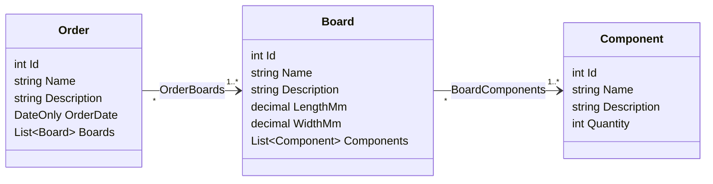
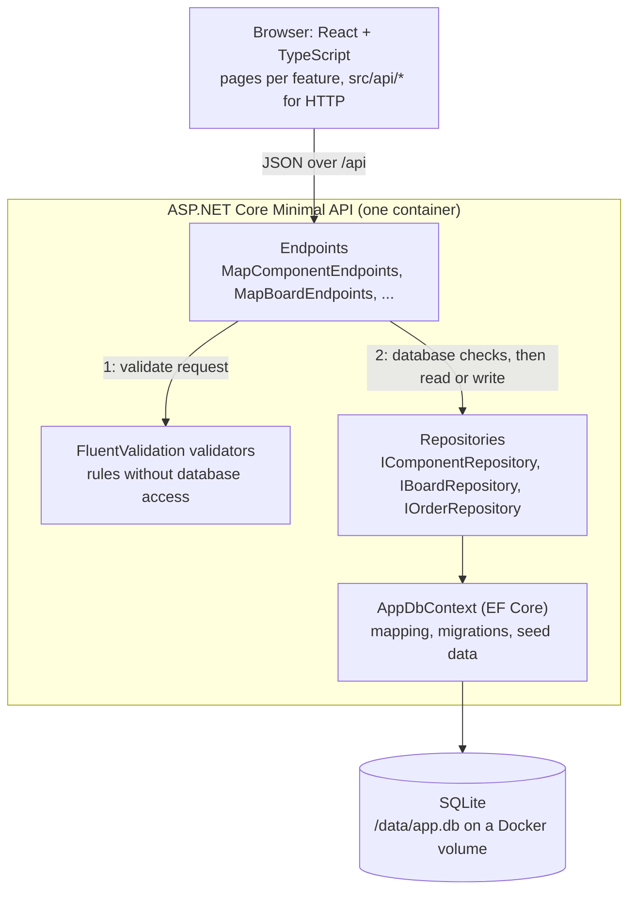
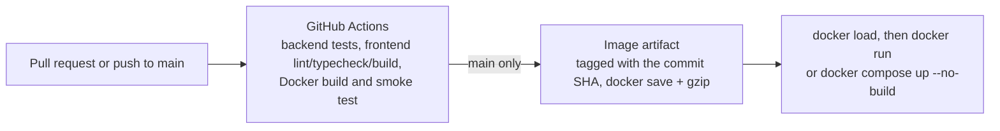

# Architecture outline

An overview of the modelled classes and how a request travels through the application. Decisions behind
these choices are in the [project handbook](project-handbook.html); coding conventions are in
[`CLAUDE.md`](../CLAUDE.md).

## Domain model

Three entities with two many-to-many relationships, as required by the challenge. Each relationship is a join
table without extra columns. `Component.Quantity` is the number of copies of the component placed on each
board that uses it, so a component is linked to a board at most once.

| Rule | Where it is enforced |
| --- | --- |
| Names are required and unique, ignoring case | Validator (required, length); `NOCASE` column with unique index; repository check before saving |
| An order needs at least one board, a board at least one component, each linked once | Request validators (`OrderRequestValidator`, `BoardRequestValidator`) |
| Deleting an order or board removes its links | Join table foreign key with `ON DELETE CASCADE` on the owning side |
| A board in an order, or a component on a board, cannot be deleted | Endpoint answers 409 Conflict; join table foreign key with `ON DELETE RESTRICT` as the safety net |

## Layers

One ASP.NET Core process serves the built React app and the JSON API. Each feature folder
(`Features/Components`, `Features/Boards`, `Features/Orders`, `Features/Search`) contains its entity, DTOs,
validator, repository and endpoints.

A write request runs in two steps:

1. The validator checks everything that needs no database (required fields, ranges, duplicates in the
   request). Errors return 400 with field keys such as `components[1].quantity`.
2. The repository checks what needs the database (unique names, referenced ids exist, record still in use),
   then stores the change. Bulk operations are all-or-nothing.

Endpoints never contain EF Core code and never return entities; they map to `record` DTOs.

## Design patterns and principles

| Pattern or principle | Where |
| --- | --- |
| Repository | `I…Repository` / `…Repository` per aggregate keep data access out of the endpoints |
| Dependency injection | Repositories (scoped), validators (singleton) and `AppDbContext` are registered in `Program.cs` and injected into endpoint handlers |
| DTO and mapping | Request and response `record`s with `From(...)` / `To…()` methods; entities stay internal |
| Reusable validation rules | Shared FluentValidation extensions (`EntityName`, `EntityDescription`, `UniqueNames`) reused by every validator |
| Extension methods for composition | `Map…Endpoints()`, `AddDatabase()`, `ApplyMigrationsAsync()` keep `Program.cs` limited to wiring |
| Single responsibility, DRY | One folder per feature; shared error responses (`ProblemResults`) and name-conflict messages (`NameConflicts`) |

## Cross-cutting concerns

- **Persistence:** SQLite through EF Core. Migrations are applied at startup and include five demo components.
- **Logging:** `ILogger<T>` with message templates. Every create, update, delete and production download is
  logged, and unhandled exceptions are logged by the exception handler.
- **Errors:** problem details (RFC 9457) for 400, 404, 409 and 500.
- **API documentation:** OpenAPI document at `/openapi/v1.json` and Swagger UI at `/swagger`.
- **Production download:** `GET /api/orders/{id}/production-download` returns the order with its boards and
  components (including Quantity) as a JSON file.

## Delivery

The image is a multi-stage build: the frontend is built with Node, the API is published with the .NET SDK,
and both are copied into the ASP.NET runtime image, which runs as the non-root user `app`.
